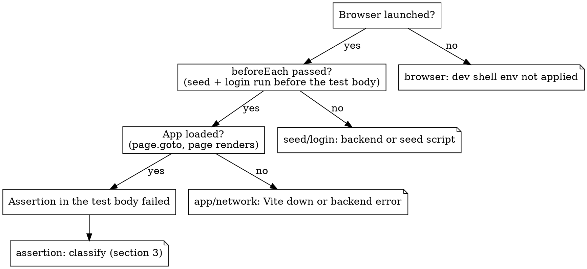

# Investigating Playwright e2e failures

## Overview

A failed e2e test tells you *that* something broke, rarely *where*. Two principles:

1. **Start from the report/trace artifact** - it is the primary evidence, not the terminal one-liner.
2. **Localize the failing layer before proposing a fix, and classify the failure before believing the
   assertion message.** "expected X visible" often means an upstream layer (browser, seed, backend, app
   load) failed and the assertion is only the first symptom.

**REQUIRED BACKGROUND:** superpowers:systematic-debugging - root cause, not symptom. **Never "fix" by
bumping a timeout or adding a sleep.**
**REQUIRED COMPANION:** **running-e2e-tests** for stack bring-up and the dev-shell run command; the
re-run commands below assume the stack is up.
**Repo conventions** (seeds, fixtures, page objects, tags) live in the e2e folder's `CLAUDE.md`
(`{{E2E_ROOT}}CLAUDE.md`). Read it; don't re-derive them.

## 1. Get the report/trace

**Local run** (reporter `html`, `trace: 'retain-on-failure'`): HTML report in `playwright-report/`; trace
and screenshots in `test-results/<test-dir>/`. Discover paths, don't assume them:
`find test-results -name trace.zip`, `find test-results -name '*.png'`.

**CI failure (GitHub Actions):** pull the uploaded report artifact (per-shard blob reports, merged report),
don't guess from CI logs:

```
gh run view <run-id>
gh run download <run-id> -n playwright-report-merged
```

**Read headlessly** (GUI viewers like `show-trace`, `show-report`, `--ui`, `--headed`, `--debug` need a
display):

- The trace zip holds network, console and DOM snapshots: list it, then extract entries (network/console
  are NDJSON) and look for the failing request and console errors.
- Fastest visual tell: force a screenshot on an investigative re-run and read the PNG:
  ```
  {{DEVSHELL}} yarn playwright test <spec> -g "<title>" --project=chromium --screenshot=only-on-failure --trace=on --reporter=list
  ```

## 2. Which layer broke? (check in execution order)



| Layer | Signal | Likely cause | Next step |
|-------|--------|--------------|-----------|
| **Browser** | "Executable doesn't exist" / launch error / browser from `~/.cache` | Ran outside the dev shell | Check `PLAYWRIGHT_BROWSERS_PATH` points at the pinned browser (running-e2e-tests) |
| **Seed / login** | Fails in `beforeEach`; POST to `{{SEED_ENDPOINT}}` errors | Command not found / not mounted (backend not in test env, not up, wrong `BACKEND_URL`) / script raised | Read the response body (starting-the-e2e-backend "Seed endpoint"); confirm the backend is up on YOUR hashed port; for a 500 read the backend log + the seed file (section 4) |
| **App / network** | `page.goto` timeout; error or blank screen | Vite down, OR a backend GraphQL/REST call failed and the app rendered empty | Confirm `{{FRONTEND_URL}}/login`; check trace network + backend log for 4xx/5xx |
| **Assertion** | `expect(...)` fails after load | See section 3 | Classify |

## 3. Classify an assertion failure

| Class | Tell | Resolution |
|-------|------|-----------|
| **Real regression** | Fails every run; screenshot shows the app genuinely wrong | Product bug: report it for developers (see qa-e2e-test-only-changes); don't bend the test |
| **Stale / renamed selector** | The locator / `data-testid` no longer exists in the app or page object | Reconcile the test/page object with the current component |
| **Backend contract gap** | Trace shows GraphQL `400` (unknown arg/field) or `500`; app empty | Backend on the commit under test doesn't support what is sent; not a frontend-test bug |
| **Seed-data** | App loads but the value is wrong, OR an element is conditionally omitted because the seed produced no data | Fix the assertion, or fix the seed so it produces what the test expects |
| **Flaky / timing** | Passes on some re-runs; fails at different points | Race: use web-first auto-retrying `expect` and wait on the real condition, never a hardcoded wait |
| **Local-env mismatch** | Fails 100% locally, GREEN in CI on the same tree; e.g. a redirect to a port nothing listens on, or the app stuck on `/login` after an auth round trip | An env value is pinned to a CI-shaped default (e.g. a callback host on CI's fixed port), or the dev server booted without CI's env block. Fix the local env (starting-the-e2e-backend, running-e2e-tests). **Before calling any local failure "pre-existing", check CI on the same SHA**: red-locally / green-in-CI is evidence about the harness, not the app |

Classify flaky vs deterministic by re-running the isolated test (local retries are `0`; one failure proves
nothing):

```
{{DEVSHELL}} yarn playwright test <spec> -g "<title>" --project=chromium --repeat-each=5
```

Consistent fail = deterministic; mixed = flaky. Flaky still means a root cause to find, not a label.

## 4. Deeper tools

**Read the seed the test uses - early.** Most specs' `beforeEach` calls `server.seed('seeds/<path>')`
(plus a clean + login from the auto fixture). That seed *is* the test's world; a missing or wrong record
produces exactly the "element not found" / "wrong value" symptoms that look like frontend bugs. Find the
seed call(s), read the matching script in YOUR backend worktree at `$be_wt/{{SEED_DIR}}/<path>.rb`, and
confirm it produces what the assertion expects. The test env has no hot reload: **restart the backend
after editing a seed.**

**Reproduce the steps manually.** With a display: `yarn playwright codegen {{FRONTEND_URL}}`. Headless:
a throwaway script in the dev shell that performs the test's actions one at a time with a screenshot after
each, then read each PNG.

**Vendor-A mock (`{{MOCK_TOOL}}`, `{{VENDOR_A_MOCK_PORT}}`).** Vendor-A-path tests hit the mock; the
helper reads its transaction log over the mock's **admin API**. To see what it received:
`curl -s "http://localhost:{{VENDOR_A_MOCK_PORT}}/<admin-log-path>?page=1&limit=100"`. The mock is not
started locally by default: start it per starting-the-e2e-backend and export `{{VENDOR_A_MOCK_URL_ENV}}`,
or read its log from the CI run's artifacts. If the failure traces to a missing/wrong mock route or a
hardcoded value that should be echoed, the fix belongs in the mock via `editing-backend-seeds-and-mocks`
(not included in this kit): dynamic responses, routes from the vendor's own API docs.

**VCR cassettes (a different mechanism from the mock server).** Specs that replay recorded HTTP via VCR
fail with `VCR::Errors::UnhandledHTTPRequestError` in the backend log - a backend-env issue, not an app
regression:
- *"There is currently no cassette in use"*: the backend runs more than one Puma thread (cassette state is
  thread-local). Reboot single-thread (see starting-the-e2e-backend).
- *"VCR can not find a suitable HTTP interaction"* after single-threading: host/URI mismatch between the
  request and the recorded cassette. Investigate as an env mismatch; `VCR_DEBUG=1` writes the exact
  request vs cassette to the log.

**Backend console - LOCAL e2e backend ONLY.** To inspect what a seed created:

```
cd $be_wt && SPORE_TASK_SLUG=$slug {{SERVICES_WRAPPER}} exec bundle exec rails c -e test
```

WARNING: only ever your local per-slug test backend. NEVER open a console or run commands against
staging, production or any remote environment.

## Integration-project failure triage

The integration project drives a multi-service stack (backend -> queue server -> gateway -> `{{VENDOR_B}}`
mock, optionally object storage). Most of its failures are harness causes, not app regressions. Match the
symptom first:

| Symptom | Most likely cause (NOT a regression) | Check |
|---------|--------------------------------------|-------|
| An assertion on an async write-back times out | Race between a synchronous gate and the async write-back, or a mock default state that legitimately blocks the flow | Read the gate's condition and the mock's default response before calling it a bug |
| Seed 500 / RPC timeout / primary-key collision in the gateway | Gateway DB not reset; a key sequence behind fixture rows makes the create RPC collide and never reply | Reset gateway state (starting-the-e2e-backend, integration step 3) |
| Every spec red before the first assertion (pre-test purge) | `localhost` resolved to `::1` vs an IPv4-only mock, or a mock killed by a tee pipe | Use `127.0.0.1`; boot mocks with `exec` |
| A "missing field" bug in the backend | You read the default branch, not the branch the stack actually runs | Read code on the exact commit under test |
| "Listening" but unreachable (curl 000) | Agent shell's network namespace != the stack's | Run checks and Playwright from a pane in the stack's namespace |
| Bare test timeout with no diagnostic on a storage flow | Storage env missing on the backend or the subscriber daemon | Inspect `/proc/<pid>/environ` of both |

## Common mistakes

| Mistake | Fix |
|---------|-----|
| Investigating from the terminal one-liner | Pull the report/trace first (section 1) |
| Trusting the assertion message and editing the assertion | Localize the layer first |
| Bumping the timeout / adding `waitForTimeout` | Masks a race. Wait on the real condition with web-first assertions |
| Declaring "flaky" or "infra" from one run | `--repeat-each=5`; local retries are `0` |
| GUI trace viewer on a headless host | Extract the trace zip, forced screenshot + read, `--reporter=list`, backend log |
| Assuming a GraphQL `400` is a test bug | Usually a backend contract gap on the commit under test |
| Calling a local-only red "pre-existing" | Compare with CI on the same SHA; diff your env against CI's |
| Console on the wrong environment | Local per-slug test backend only |
| Editing seeds in the frontend repo | Seeds live in the backend (`{{SEED_DIR}}`); restart the backend after editing |
